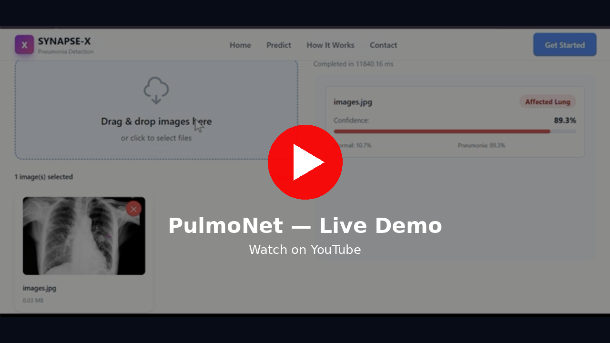
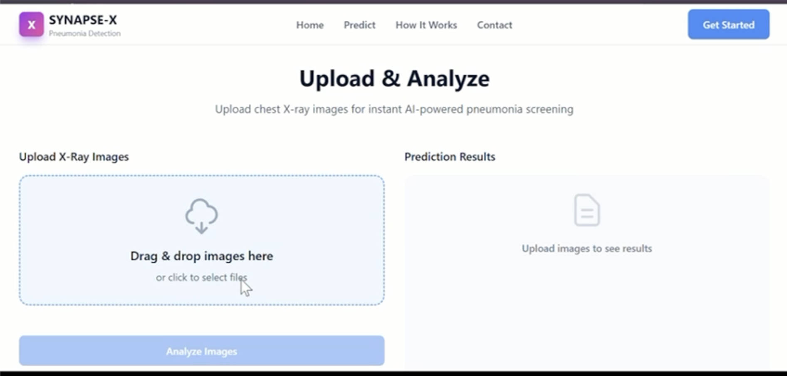
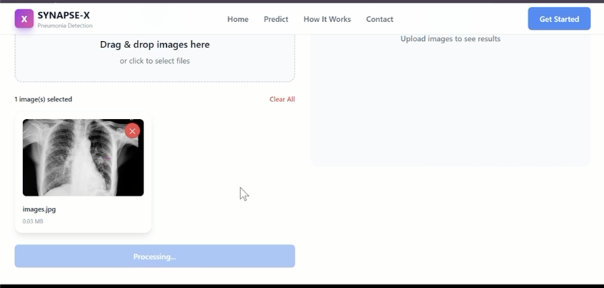
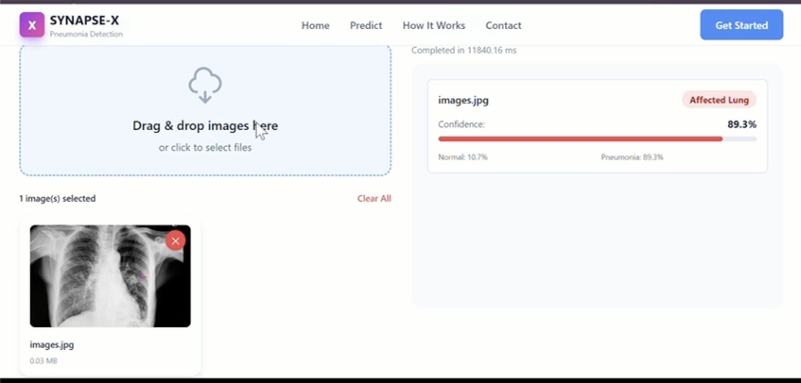
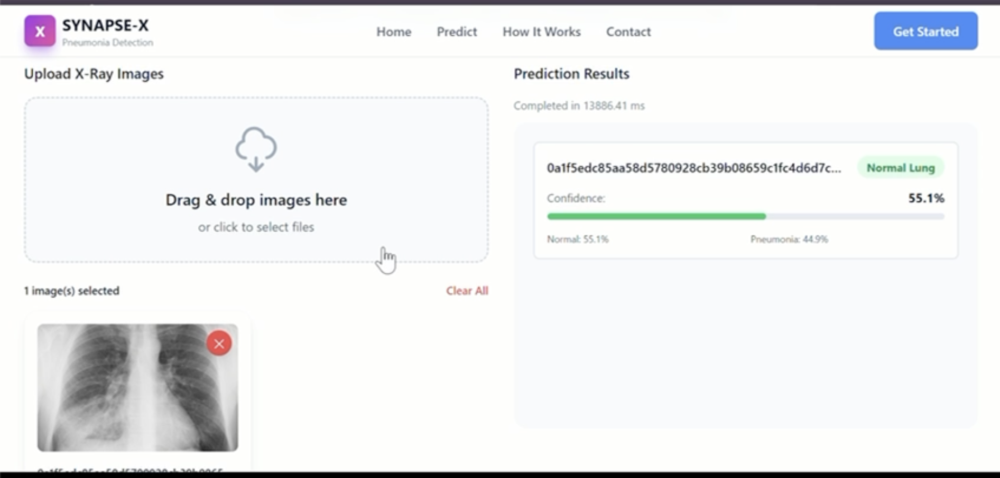

<div align="center">

# 🫁 PulmoNet

### Pneumonia screening from chest X-rays — upload a scan, get a result in seconds.

A full-stack deep learning application that pairs a **ResNet-50 classifier** with a **classical computer-vision pipeline** (CLAHE enhancement, bilateral denoising, lung segmentation) behind a fast REST API and a clean React interface.


<br>

[](https://pulmo-net.vercel.app/)
[](https://youtu.be/DTXY-IxtPzg)

<br>

## 🎬 See it in action

<a href="https://youtu.be/DTXY-IxtPzg">
  
</a>

<sub>▶ Click the preview to watch the full walkthrough: uploading chest X-rays and getting live predictions from the deployed app.</sub>

<br><br>

## 📸 Screenshots

<table>
  <tr>
    <td align="center" width="50%">
      <br>
      <b>Upload &amp; Analyze workspace</b>
    </td>
    <td align="center" width="50%">
      <br>
      <b>X-ray selected, inference running</b>
    </td>
  </tr>
  <tr>
    <td align="center" width="50%">
      <br>
      <b>Pneumonia detected — 89.3% confidence</b>
    </td>
    <td align="center" width="50%">
      <br>
      <b>Normal lung — per-class probabilities</b>
    </td>
  </tr>
</table>

<br>

[Features](#-features) · [How it works](#-how-it-works) · [Getting started](#-getting-started) · [API](#-api-reference) · [Team](#-team)

</div>

---

## 🌐 Live deployment

| | |
|---|---|
| **Frontend** | [pulmo-net.vercel.app](https://pulmo-net.vercel.app/) on Vercel |
| **Backend** | FastAPI + PyTorch (CPU) on Render |
| **Demo video** | [youtu.be/DTXY-IxtPzg](https://youtu.be/DTXY-IxtPzg) |

> 💤 The backend runs on a free tier that sleeps when idle. If the first prediction takes 30–60 seconds, it's waking up — after that, results come back in a few seconds.

---

## 📖 Why PulmoNet?

Pneumonia is one of the leading causes of death worldwide, especially among children and the elderly, and chest X-rays are the frontline tool for diagnosing it. Reading them takes trained radiologists — who are scarce in many regions — and time that patients don't always have.

PulmoNet is our attempt at a **second pair of eyes**: a screening tool that flags likely pneumonia cases so they can be prioritised for expert review. It is built end to end — from image preprocessing and a trained CNN to a production-style API and a web interface anyone can use.

> ⚠️ PulmoNet is a research and educational project. It is **not** a medical device and must not be used as a substitute for diagnosis by a qualified clinician.

---

## ✨ Features

| | |
|---|---|
| 🧠 **Deep learning inference** | ResNet-50 backbone with a dropout + single-logit head, fine-tuned for binary Normal / Pneumonia classification |
| 🔬 **Medical-grade preprocessing** | Min-max normalisation → resize to 256×256 → CLAHE contrast enhancement → bilateral denoising |
| 🫁 **Lung segmentation** | Threshold + morphology + connected-component filtering isolates the lung fields from the spine, heart and shoulders |
| 🔁 **Graceful fallback** | If the model weights or PyTorch are unavailable, a feature-based classifier (intensity, histogram, texture, lung-area features) keeps the API serving |
| 📦 **Batch analysis** | Upload up to 10 X-rays at once, each scored independently with its own confidence |
| 🖱️ **Drag-and-drop UI** | Instant previews, per-image result cards, confidence bars and clear error states |
| 🛡️ **Input validation** | Extension + MIME checks, 10 MB per-file cap, batch-size limits, sanitised error responses |
| ⚙️ **Swappable checkpoints** | Two trained variants ship in the repo; choose one with a single env var |
| 🪶 **Lightweight deploys** | CPU-only PyTorch build so the backend fits on free-tier hosts (≈512 MB RAM) |

---

## 🔍 How it works

```
 ┌──────────────┐     multipart/form-data     ┌───────────────────────────────────────────────┐
 │  React UI    │ ──────────────────────────▶ │ FastAPI  /api/predict                          │
 │  (Vite +     │                             │                                                │
 │  Tailwind)   │ ◀────────────────────────── │  1. Validate type / size / count               │
 └──────────────┘     JSON predictions        │  2. Decode → grayscale                         │
                                              │  3. Normalise → 256×256 → CLAHE → bilateral    │
                                              │  4. Segment lungs (fallback-safe)              │
                                              │  5. ResNet-50 → sigmoid → probability          │
                                              │     └─ no model? feature-based classifier      │
                                              └───────────────────────────────────────────────┘
```

**Model.** A ResNet-50 (bottleneck blocks, layers `3-4-6-3`) whose classifier head is replaced with `Dropout(0.5) → Linear(2048, 1)`. The grayscale scan is replicated across three channels, passed through the network, and the sigmoid of the output logit gives the pneumonia probability. Predictions at or above 0.5 are labelled *Pneumonia*.

**Checkpoints.** Two trained weight files live in `backend/models/`:

| File | Description |
|---|---|
| `model_clahe.pth` | Trained on CLAHE-enhanced images (default, `MODEL_VARIANT=clahe`) |
| `best_model.pth` | Best checkpoint from the baseline training run |

The loader understands plain `state_dict`s, full pickled modules, and multi-variant checkpoint dictionaries, so you can drop in new weights without touching code.

---

## 🗂️ Project structure

```
PulmoNet/
├── backend/
│   ├── main.py                 # FastAPI app, CORS, logging, error handlers
│   ├── schemas.py              # Pydantic response models
│   ├── routes/
│   │   └── predict.py          # /api/predict, /api/analyze, /api/predict/config, /api/health
│   ├── services/
│   │   ├── xray_model.py       # ResNet-50, preprocessing, lung segmentation, feature fallback
│   │   └── model_loader.py     # Singleton model loading + warm-up
│   ├── utils/
│   │   └── preprocess.py       # Image validation & preprocessing helpers
│   ├── models/                 # Trained .pth checkpoints
│   ├── test_model.py           # Model integration tests
│   └── requirements.txt
│
└── frontend/
    ├── src/
    │   ├── components/         # Navbar, Hero, UploadArea, PredictionCard, …
    │   ├── services/apiService.js
    │   ├── App.jsx
    │   └── index.jsx
    ├── index.html
    ├── vite.config.js
    └── tailwind.config.js
```

---

## 🚀 Getting started

### Prerequisites

- Python **3.10+**
- Node.js **18+** and npm

### 1 · Clone

```bash
git clone https://github.com/variablePotato/PulmoNet.git
cd PulmoNet
```

### 2 · Backend

```bash
cd backend
python -m venv venv
source venv/bin/activate          # Windows: venv\Scripts\activate
pip install -r requirements.txt
cp .env.example .env              # optional: tweak MODEL_VARIANT, PORT, CORS
python main.py
```

The API is now live at **http://localhost:8000** — interactive docs at **http://localhost:8000/docs**.

### 3 · Frontend

```bash
cd frontend
npm install
cp .env.example .env              # VITE_API_URL=http://localhost:8000/api
npm run dev
```

Open **http://localhost:3000**, drop in a chest X-ray, and hit analyse.

### Configuration

| Variable | Where | Default | Purpose |
|---|---|---|---|
| `PORT` | backend | `8000` | API port |
| `MODEL_VARIANT` | backend | `clahe` | Which checkpoint variant to load |
| `VITE_API_URL` | frontend | `http://localhost:8000/api` | Backend base URL |
| `VITE_API_TIMEOUT_MS` | frontend | `60000` | Request timeout |
| `VITE_API_RETRIES` | frontend | `1` | Retries on network failure |

---

## 📡 API reference

| Method | Endpoint | Description |
|---|---|---|
| `GET` | `/api/health` | Service and model status |
| `GET` | `/api/predict/config` | Accepted formats and upload limits |
| `POST` | `/api/predict` | Classify one or more X-rays |
| `POST` | `/api/analyze` | Alias of `/predict` |

**Example**

```bash
curl -X POST http://localhost:8000/api/predict \
  -F "files=@chest_xray_1.png" \
  -F "files=@chest_xray_2.jpg"
```

```json
[
  {
    "filename": "chest_xray_1.png",
    "prediction": "Pneumonia",
    "confidence": 96.4,
    "probability_normal": 0.036,
    "probability_pneumonia": 0.964,
    "status": "success"
  }
]
```

**Limits:** JPG / JPEG / PNG only · max 10 MB per file · max 10 files per request.

---

## 🧪 Testing

```bash
cd backend
python test_model.py
```

Verifies that the checkpoint loads, the preprocessing pipeline produces the expected tensor shape, and inference returns well-formed predictions.

---

## ☁️ Deployment

**Backend** — any Python host works. The CPU-only PyTorch wheel keeps memory low enough for free tiers such as Render:

```bash
uvicorn main:app --host 0.0.0.0 --port $PORT
```

**Frontend** — build static assets and serve them from Vercel, Netlify or any CDN:

```bash
npm run build      # outputs to frontend/dist
```

Remember to set `VITE_API_URL` to your deployed backend and add the frontend origin to the backend's CORS list.

---

## 🛣️ Roadmap

- [ ] Grad-CAM heatmaps to show *where* the model is looking
- [ ] Multi-class output (bacterial vs. viral pneumonia)
- [ ] Downloadable PDF screening report per scan
- [ ] Docker Compose setup for one-command local runs
- [ ] Published evaluation metrics (accuracy, sensitivity, specificity, AUC) on a held-out test set

---

## 👥 Team

PulmoNet was designed and built by:

| | Name | GitHub |
|---|---|---|
| 🧑‍💻 | **Aryan Raj** | [@ARYAN10227](https://github.com/ARYAN10227) |
| 🧑‍💻 | **Ayush Kumar** | [@variablePotato](https://github.com/variablePotato) |

Found a bug or have an idea? [Open an issue](https://github.com/variablePotato/PulmoNet/issues) — contributions are welcome.

---

## ⚕️ Medical disclaimer

PulmoNet is intended for research and educational purposes only. Its outputs are probabilistic screening signals, **not diagnoses**. Every result must be reviewed by a qualified healthcare professional before any clinical decision is made.

<div align="center">

<br>

Made with ☕ and a lot of chest X-rays.

</div>

